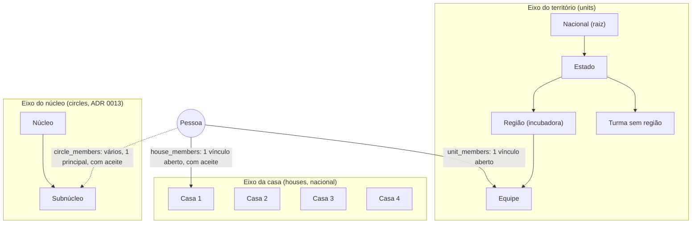
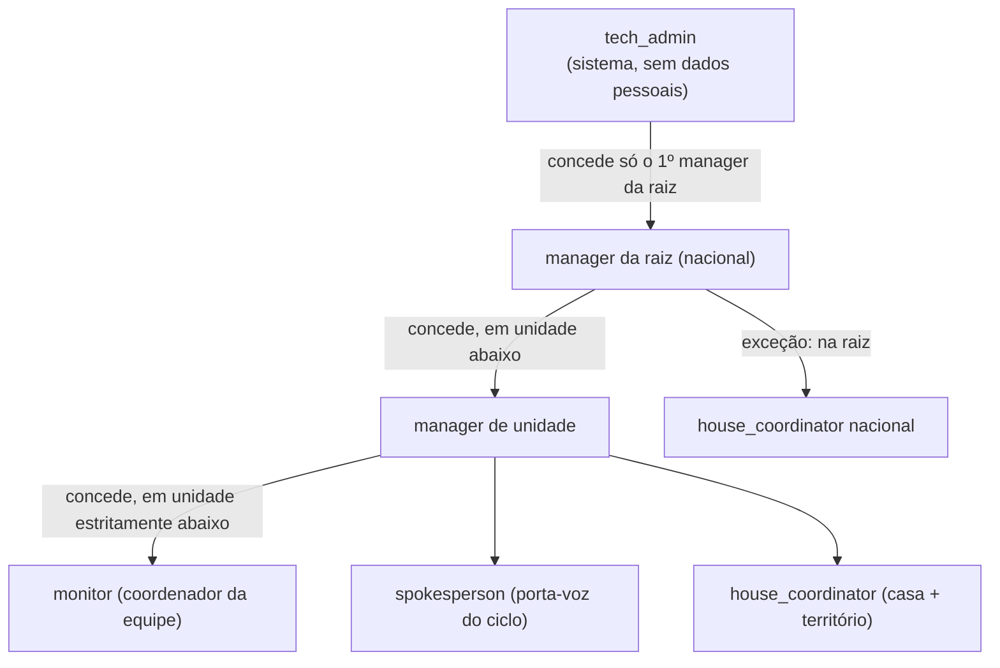
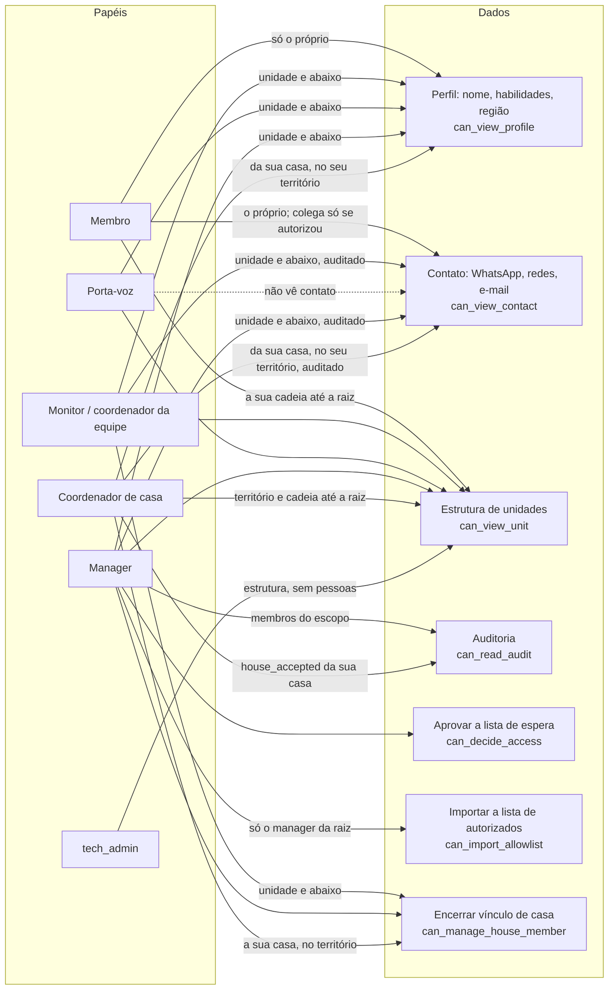
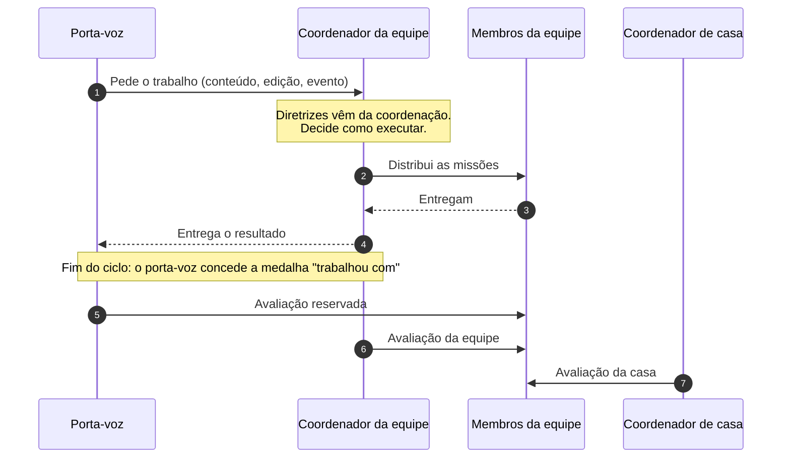
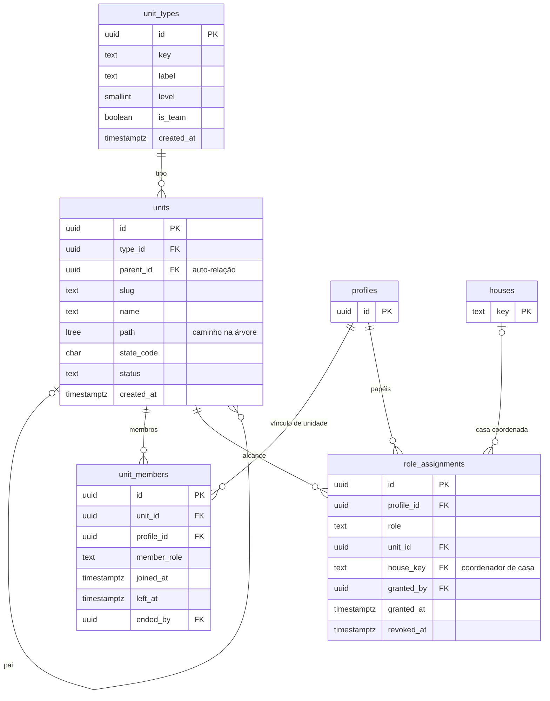
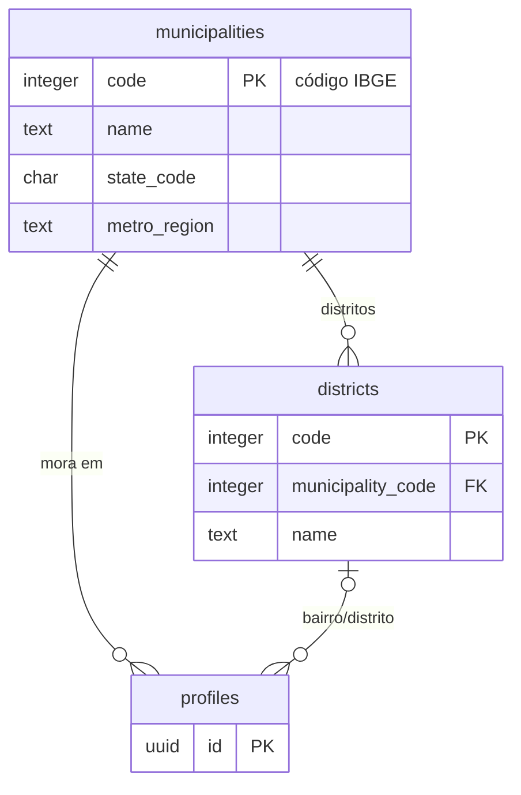
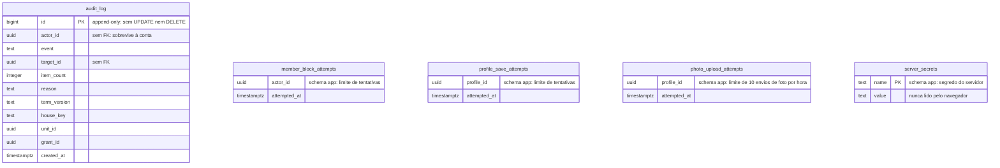

# Diagramas: estrutura, papéis e fluxo do pedido

Visão geral para quem chega. A fonte da verdade continua sendo os ADRs
([0002](adr/0002-permissoes-hierarquicas.md), [0005](adr/0005-framework-e-hierarquia-generica.md),
[0007](adr/0007-equipes-rotativas-medalhas-avaliacao.md), [0008](adr/0008-acesso-casas-avaliacao-dupla.md),
[0010](adr/0010-visibilidade-do-contato.md), [0011](adr/0011-casa-nacional-coordenador-por-territorio.md)
e, proposto, [0013](adr/0013-nucleos-fora-do-territorio.md))
e as funções `app.can_*` das migrations. Os diagramas mostram o que está decidido; o que ainda é
intenção do stakeholder vem marcado.

> Revisão com o stakeholder: **pendente** (issue #67).

## 1. Unidades e hierarquia (ADR 0005, 0008, 0011)

Há **dois eixos independentes** (e, proposto, um terceiro: o núcleo). O território é uma árvore (`units`, com `ltree`); a casa é uma
trilha nacional, fora da árvore (`houses`). Cada pessoa tem **um vínculo de território aberto**
(`unit_members`) e **um vínculo de casa aberto** (`house_members`).

- A regra de escopo é uma só: quem tem papel na unidade **U** enxerga **U e tudo abaixo**
  (`path <@`). A região e a turma sem região são opcionais por instância.
- A casa não tem relação com o município. O **coordenador de casa** tem casa **e** território
  (`unit_id` + `house_key`): vê as pessoas ativas daquela casa cujo vínculo de território está
  nele ou abaixo.
- Quem ainda está em `waitlisted` não aparece em nenhum dos dois eixos (ADR 0008 §1).
- **Núcleo (ADR 0013, aceito; sem código ainda):** árvore própria (`ltree`) de núcleos e subnúcleos, fora do
  território, com pessoas de regiões diferentes. Valem **duas hierarquias juntas**: a árvore diz
  *onde* a pessoa alcança e o cargo diz *o quê* ela faz. Só o nível de topo desce a árvore: vê o
  núcleo e os subnúcleos abaixo e pode **remover** pessoas deles (auditado). **A entrada é
  aprovada só pelo topo do próprio núcleo**; o de núcleo acima não aprova. Os cargos intermediários
  valem dentro de cada núcleo. Sem vista para cima nem para os lados, e sem localização.

## 2. Papéis e quem concede quem

`monitor` e `spokesperson` nunca concedem. Regras (`app.can_grant_role`, `app.can_revoke_role`):

- Só um `manager` **ativo** concede, em unidade **estritamente abaixo** da sua. Ninguém concede a si
  mesmo.
- Revoga quem concedeu ou um `manager` acima da unidade. Na raiz, o `manager` ativo da raiz revoga
  também o coordenador nacional de casa, mesmo sem tê-lo concedido (ADR 0011 §5).
- A pessoa comum (membro) não tem linha em `role_assignments`: é só o vínculo.

## 3. O que cada papel vê

Resumo em tabela (o que as funções permitem hoje):

| Papel | Perfil | Contato | Auditoria | Concede papéis |
|---|---|---|---|---|
| Membro | o próprio | o próprio; colegas se ele autorizou (equipe; casa há 7 dias no mesmo território, ADR 0010) | os próprios eventos de casa | não |
| Monitor | escopo | escopo | não | não |
| Porta-voz | escopo | **não** | não | não |
| Manager | escopo | escopo | membros do escopo | monitor, manager, porta-voz e coordenador de casa, abaixo |
| Coordenador de casa | membros da casa no território | idem | `house_accepted` da casa | não |
| tech_admin | **nenhum** | **nenhum** | não | só o 1º manager da raiz |

"Escopo" é a unidade do papel e tudo abaixo. Todo acesso a contato gera `contact_viewed`.
Pessoas que não estão ativas não veem nem são vistas.

## 4. Fluxo do pedido: porta-voz → coordenador da equipe → membros

> **Intenção do stakeholder (reunião de kickoff), ainda sem tabela nem função no banco.** Missões
> e pedidos entram em março. Serve para alinhar a ordem de quem decide, não para implementar.

- O membro **roda** entre porta-vozes: a equipe é da organização, não do porta-voz (ADR 0007 §2).
- O porta-voz só vê o perfil (nome, habilidades, portfólio, medalhas) de quem está na unidade do
  seu papel; não vê contato.
- As avaliações ficam desligadas até o parecer jurídico. Cada uma só é lida por quem avaliou; a
  hierarquia lê por pedido auditado (ADR 0007 §4).

## 5. Modelo de dados

Gerado das migrations de `supabase/migrations` (schema `public` e as tabelas relevantes de `app`),
um diagrama por área. Legenda: `PK` chave primária, `FK` chave estrangeira, **cifrado** = AES-GCM no
servidor (ADR 0003; o banco só guarda o texto cifrado), **HMAC** = valor derivado para busca ou
unicidade, sem o dado em claro. Os campos listados são os principais; o detalhe de cada coluna, as
regras e as RLS estão em [MODELO_DADOS.md](MODELO_DADOS.md). O teste `tests/diagrama-modelo-de-dados.test.ts`
confere que toda tabela criada nas migrations aparece aqui: **PR que muda o schema atualiza este diagrama.**

### 5.1 Pessoas e acesso

```mermaid
erDiagram
    profiles {
        uuid id PK "= auth.users.id"
        text display_name_enc "cifrado"
        integer municipality_code FK
        integer district_code FK
        char state_code
        text neighborhood_enc "cifrado"
        text status
        text access_status
        text consent_version
        timestamptz consent_at
    }
    access_allowlist {
        uuid id PK
        text email_hmac "HMAC"
        text source
        uuid added_by FK
        timestamptz added_at
    }
    access_waitlist_hmac {
        uuid profile_id PK, FK
        text email_hmac "HMAC"
        timestamptz created_at
    }
    consent_acceptances {
        uuid user_id PK "auth.users.id"
        text version PK
        timestamptz accepted_at
    }
    profile_contacts {
        uuid profile_id PK, FK
        text whatsapp_enc "cifrado"
        text whatsapp_hmac "HMAC"
        text social_links_enc "cifrado"
        timestamptz updated_at
    }
    profile_background {
        uuid profile_id PK, FK
        text education_level_enc "cifrado"
        text education_detail_enc "cifrado"
        text occupation_enc "cifrado"
        timestamptz updated_at
    }
    profile_photos {
        uuid profile_id PK, FK
        text photo_enc "cifrado"
        timestamptz updated_at
    }
    contact_visibility {
        uuid profile_id PK, FK
        text kind PK
        text scope
        timestamptz updated_at
    }
    skills {
        uuid id PK
        text name
        text category
        text_array aliases
        boolean active
    }
    profile_skills {
        uuid profile_id PK, FK
        uuid skill_id PK, FK
    }
    skill_suggestions {
        uuid id PK
        uuid profile_id FK
        text name "texto livre da pessoa; vira nome do catálogo se aprovado"
        text status "open, approved ou rejected"
        uuid decided_by FK "coordenação nacional"
        timestamptz decided_at
        timestamptz created_at
    }
    profile_badge_prefs {
        uuid profile_id PK, FK
        text badge_kind PK "house ou totem"
        smallint position "ordem no perfil público"
        boolean shown
        timestamptz updated_at
    }
    profiles ||--o| access_waitlist_hmac : "espera"
    profiles |o--o{ access_allowlist : "adicionou"
    profiles ||--o| profile_contacts : "contato"
    profiles ||--o| profile_photos : "foto"
    profiles ||--o| profile_background : "formação e atividade"
    profiles ||--o{ contact_visibility : "quem vê"
    profiles ||--o{ consent_acceptances : "aceitou o termo"
    profiles ||--o{ profile_skills : "tem"
    profiles ||--o{ skill_suggestions : "sugere"
    profiles ||--o{ profile_badge_prefs : "escolhe medalhas"
    skills ||--o{ profile_skills : "usada em"
```

### 5.2 Unidades e hierarquia (ADR 0005, 0008, 0011)

### 5.3 Casas e questionário (ADR 0008, 0011, 0014, 0016)

```mermaid
erDiagram
    houses {
        text key PK "id da casa na config"
        boolean active
        timestamptz created_at
    }
    house_members {
        uuid id PK
        uuid profile_id FK
        text house_key FK
        text join_method "self ou questionnaire"
        text consent_version FK
        timestamptz joined_at
        timestamptz accepted_at
        timestamptz left_at
        uuid ended_by FK
        boolean moved "encerrado por troca"
    }
    news {
        uuid id PK
        uuid unit_id FK "unidade da novidade; vale dela para baixo"
        text title "até 80, texto puro"
        text body "até 280, texto puro"
        text link "https opcional"
        uuid published_by FK
        timestamptz published_at
        timestamptz expires_at
        timestamptz archived_at
        uuid archived_by FK
    }
    house_transfer_window {
        boolean singleton PK "uma linha só"
        boolean is_open "aberta ou fechada, sem datas"
        timestamptz changed_at
        uuid changed_by FK
    }
    questionnaire_term_versions {
        text version PK "schema app"
        timestamptz created_at
    }
    questionnaire_consents {
        uuid profile_id PK, FK
        text term_version PK, FK
        timestamptz consented_at
    }
    questionnaire_results {
        uuid profile_id PK, FK
        text term_version FK
        text house_key FK "casa sugerida"
        text totem_enc "cifrado, interno"
        text scores_enc "cifrado, notas"
        text answers_enc "cifrado, últimas respostas; sem leitura pela API"
        text totem_state
        text source
        timestamptz created_at
    }
    house_analysis_requests {
        uuid id PK
        uuid profile_id FK
        text term_version FK
        text_array tied_axes
        text answers_enc "cifrado, só nos pedidos abertos"
        text kind "full ou totem"
        text status
        text resolution
        timestamptz opened_at
        timestamptz created_at
        timestamptz resolved_at
        uuid resolved_by FK
    }
    questionnaire_data_grants {
        uuid id PK
        uuid grantee_id FK
        uuid unit_id FK
        uuid role_assignment_id FK
        uuid granted_by FK
        timestamptz granted_at
        timestamptz revoked_at
        uuid revoked_by FK
    }
    profiles {
        uuid id PK
    }
    units {
        uuid id PK
    }
    role_assignments {
        uuid id PK
    }
    houses ||--o{ house_members : "um vínculo aberto por pessoa"
    profiles ||--o{ house_members : "casa escolhida"
    profiles ||--o{ questionnaire_consents : "aceitou o termo"
    questionnaire_term_versions ||--o{ questionnaire_consents : "versão"
    questionnaire_term_versions |o--o{ house_members : "termo do vínculo"
    profiles ||--o| questionnaire_results : "resultado"
    houses ||--o{ questionnaire_results : "casa sugerida"
    questionnaire_term_versions ||--o{ questionnaire_results : "versão"
    profiles ||--o{ house_analysis_requests : "pedido de análise"
    questionnaire_term_versions ||--o{ house_analysis_requests : "versão"
    profiles ||--o{ questionnaire_data_grants : "delegado"
    units ||--o{ questionnaire_data_grants : "escopo"
    units ||--o{ news : "publicadas em"
    role_assignments ||--o{ questionnaire_data_grants : "papel que sustenta"
```

### 5.4 Localidades

### 5.5 Auditoria e infraestrutura

## O que ainda não existe

- Colegas verem o perfil uns dos outros: hoje não veem; decisão de produto na pergunta 80 de
  [`PERGUNTAS_STAKEHOLDER.md`](PERGUNTAS_STAKEHOLDER.md).
- Núcleos, cargos internos, reuniões e presença: só o ADR 0013 (aceito), nas issues #168 a
  #170, bloqueadas por missões e pontos; pendem só as perguntas 91 a 93 (padrão conservador).
- Porta-voz do ciclo e avaliação (dupla): sem código ainda, nas issues #69 e #72. O painel da casa
  (ADR 0008 §3) e as funções `app.can_*` dele ainda não têm issue própria.
